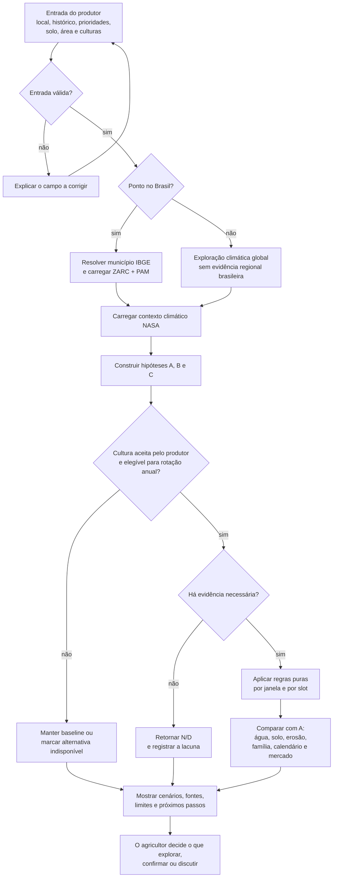
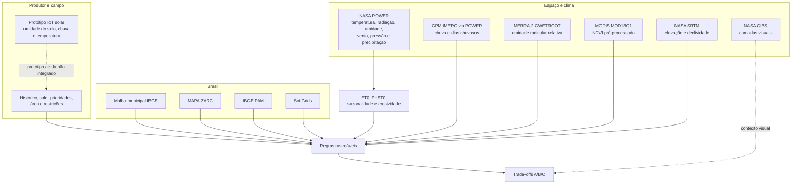
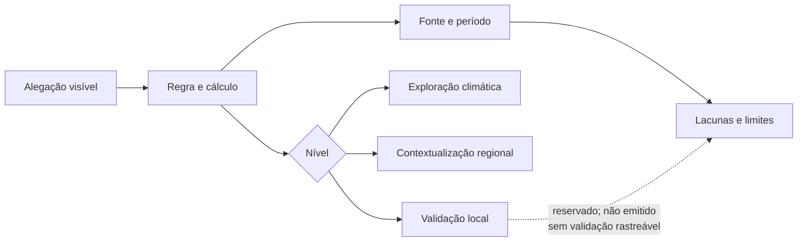

# Plantaê — from space to soil, farmers decide

<p align="center">
  
</p>

<p align="center">
  <strong>Equipe SilkNASA · Projeto Plantaê · NASA Space Apps Challenge 2026</strong>
</p>

> **What if farmers could explore their choices before planting?**
>
> Meet **Plantaê**: a visual lab where three crop rotation strategies come alive through pixel art, informed by NASA climate data.
>
> **But behind every pixel, there is science.**
>
> We combine NASA observations with soil estimates covering more than 5,000 Brazilian municipalities. Our solar-powered, low-cost IoT prototype measures soil moisture, rainfall and temperature directly in the field, complementing the spatial limits of satellite data. A virtual assistant makes complex evidence easier to understand.
>
> Farmers swap crops, compare trade-offs and explore four stages.
>
> **Plantaê. From space to soil. Farmers decide.**

Plantaê (codinome técnico **Field Shift**) é um MVP visual e bilíngue de apoio à decisão agrícola. O projeto da equipe **SilkNASA** ajuda produtores brasileiros a explorar hipóteses de rotação antes do plantio, sem esconder incertezas atrás de uma nota única e sem apresentar dados regionais como medições do talhão.

O produto não decide pelo agricultor. Ele organiza histórico climático, contexto municipal, evidências das culturas e prioridades informadas pelo produtor em três cenários comparáveis:

- **A — intenção atual:** plano confirmado pelo agricultor ou continuação claramente identificada como hipótese.
- **B — solo e cobertura:** alternativa entre culturas elegíveis, respeitando restrições do produtor e evidências disponíveis.
- **C — contexto hídrico:** alternativa com evidência térmica documentada quando possível; não promete tolerância à seca nem menor consumo de água.

Dados ausentes permanecem **N/D / desconhecidos**. As comparações são qualitativas e rastreáveis, não probabilidades de sucesso ou recomendações agronômicas.

## O problema

Uma decisão de rotação reúne perguntas que normalmente estão separadas:

- O que o agricultor já plantou e quais culturas consegue operar ou comercializar?
- Como o clima costuma se comportar na janela de cada cultivo?
- Existe registro ZARC para a cultura, município e período?
- O que está documentado sobre temperatura, ciclo, cobertura, palhada e família botânica?
- O que muda quando a prioridade é água, solo ou operação?
- Quais conclusões têm evidência, quais exigem atenção e quais ainda não podem ser respondidas?

O Plantaê transforma essas perguntas em um laboratório explorável. A pixel art comunica os cenários; o Centro de Evidências mostra regras, fontes, lacunas e limitações.

## Um pilar: acesso universal e de baixo custo a dados

Dados de satélite tornam possível observar grandes áreas, mas sua resolução espacial e temporal não representa automaticamente o que acontece em cada talhão. Uma média de grade regional não substitui uma leitura feita diretamente no solo.

Por isso, a visão do Plantaê combina duas escalas:

- **do espaço:** histórico e contexto regional acessíveis mesmo onde não existe infraestrutura de campo;
- **no solo:** um protótipo IoT de baixo custo, alimentado por painel solar, com sensores de **umidade do solo, chuva e temperatura**.

O objetivo é democratizar a coleta direta: hardware simples, energia solar e leitura local podem reduzir a barreira de entrada para agricultores com pouca conectividade ou acesso limitado a estações meteorológicas. No MVP atual, o vídeo demonstra a montagem física; as medições ainda não entram automaticamente no motor decisório e permanecem uma camada futura de evidência local.

<p align="center">
  <video src="public/assets/team/plantae-iot-assembly.mp4" controls width="720" title="Montagem do protótipo IoT Plantaê"></video>
</p>

**[Assistir ao vídeo da montagem do IoT Plantaê](public/assets/team/plantae-iot-assembly.mp4)**

## Jornada do agricultor

```mermaid
flowchart LR
    A[Escolher local<br/>mapa, busca ou coordenadas] --> B[Conversar com João<br/>ou preencher a fazenda]
    B --> C[Informar histórico, solo,<br/>prioridades e restrições]
    C --> D[Gerar cenários<br/>A, B e C]
    D --> E[Editar quatro slots<br/>no Laboratório]
    E --> F[Comparar trade-offs<br/>e evidências]
    F --> G[Explorar quatro estágios<br/>em histórias pixel art]
    G --> H[Levar perguntas e evidências<br/>à assistência técnica]

    F -. trocar cultura .-> E
    E -. recalcular análise .-> F
```



Os quatro slots representam **Ano 1/2 × Temporada A/B**. São espaços neutros: nenhum slot recebe data, duração ou calendário inventado. As quatro etapas de Future Farm Stories visualizam as hipóteses; continuam sendo cenários, não previsões.

## Fluxo decisório



### O que pode alterar uma análise

- plano-base e histórico informados pelo produtor;
- localização e identidade municipal;
- culturas disponíveis, aceitas ou bloqueadas;
- janelas mensais declaradas ou documentadas;
- prioridades, que mudam a **ordem de atenção**, não os fatos;
- parâmetros agrícolas documentados;
- observações climáticas históricas e indicadores reproduzíveis.

O motor nunca converte ausência em zero e nunca conclui aptidão agrícola apenas pelo clima.

## Como cada base é usada



| Base | Uso atual | Valor para o agricultor | Limite |
| --- | --- | --- | --- |
| **NASA POWER** | Histórico climático e entradas para ET0 FAO-56 | Mostra como o clima costuma se comportar na janela | Grade regional; não é sensor nem previsão |
| **GPM IMERG via POWER** | Totais históricos e distribuição de dias com chuva | Separa quantidade de frequência da chuva | Chuva não é demanda da cultura |
| **MERRA-2 GWETROOT** | Índice relativo de umidade na zona radicular | Acrescenta contexto hídrico além da chuva | Não é umidade volumétrica do talhão |
| **MODIS MOD13Q1** | NDVI pré-processado e verificado em pontos demonstrativos agrícolas | Acrescenta sinal histórico de verdor | Apenas pontos preparados; não diagnostica a fazenda |
| **NASA SRTM** | Elevação, classes de declividade e hotspots de relevo | Torna o relevo visível na discussão de solo exposto | Não calcula perda de solo |
| **NASA GIBS** | Camadas visuais datadas de SMAP, chuva e imagem | Permite explorar o contexto espacial | Cores do raster não viram medições |
| **Malha IBGE** | Coordenada → município versionado | Conecta o ponto às bases municipais corretas | Município não confirma propriedade ou uso agrícola |
| **MAPA ZARC** | Registro por cultura, município e período | Mostra o zoneamento oficial aplicável ao slot | Ausência não significa inadequação; não é garantia |
| **IBGE PAM** | Área colhida municipal por produto | Indica existência de cadeia produtiva registrada | Não informa preço, lucro ou viabilidade |
| **SoilGrids** | Estimativas 0–30 cm em pontos de referência municipais | Ponto de partida de baixo custo sobre textura, pH e carbono | Estimativa espacial, não análise laboratorial |
| **Dados do produtor** | Histórico, plano, solo local, culturas e prioridades | Mantém a comparação ligada à realidade operacional | Informação declarada fica separada de observações externas |
| **Open-Meteo** | Tempo atual e previsão em painel independente | Contexto meteorológico de curto prazo | Não é NASA, medição ou recomendação |
| **Protótipo IoT solar** | Demonstra coleta direta de umidade do solo, chuva e temperatura com alimentação fotovoltaica | Oferece um caminho universal e de baixo custo para complementar limites dos satélites com evidência local | Ainda não alimenta automaticamente o motor deste repositório |

Fontes, licenças e proveniência: [SOURCES](docs/SOURCES.md) e [METHOD](docs/METHOD.md).

## O que o agricultor recebe

### Três alternativas, sem nota opaca

O produtor vê A/B/C lado a lado. O cenário A continua sendo a referência; B e C não substituem silenciosamente o plano informado.

### Seis eixos de trade-off

1. **Água:** histórico `P − ET0` na mesma janela e Kc documentado quando disponível. Não calcula ETc ou irrigação.
2. **Solo:** cobertura, fixação de N documentada, palhada e diversidade de famílias.
3. **Erosão:** meses potencialmente descobertos, erosividade da chuva e declividade SRTM. Não calcula RUSLE.
4. **Família/doenças:** repetição botânica imediata; doenças só aparecem com fonte.
5. **Calendário:** leitura ZARC por cultura, janela e município.
6. **Mercado/operação:** contexto PAM e restrições do produtor; sem previsão de preço ou lucro.

Os estados são **referência**, **melhor que A**, **parecido com A**, **pior que A** e **não sabemos**. “Melhor” ou “pior” vale somente para aquele eixo.

### Evidência inspecionável



- **Exploração climática:** há clima, mas não evidência regional suficiente.
- **Contextualização regional:** existe correspondência entre município e cultura no pacote carregado.
- **Validação local:** reservada para futura validação rastreável; o MVP não a emite.

### João explica em linguagem cotidiana

João recebe o ponto do mapa, coleta dados da fazenda e explica evidências sem esconder desconhecidos. O ditado funciona em `pt-BR` e `en-US`, preenche o campo para revisão e não envia automaticamente. O leitor de página oferece iniciar, pausar, continuar, reiniciar e parar.

O Gemini é opcional e usado somente no protótipo `/results3`, com `GEMINI_API_KEY` no servidor. A saída passa por validação de esquema e tem fallback determinístico. O motor A/B/C é baseado em regras e não depende de IA generativa.

## Arquitetura

```mermaid
flowchart LR
    UI[Next.js + React<br/>Atlas, João, Fazenda, Lab, Resultados] --> API[APIs validadas<br/>com Zod]
    API --> NASA[Adaptadores NASA e clima]
    API --> DATA[Artefatos regionais versionados]
    API --> ENGINE[Motor TypeScript puro]
    ENGINE --> EVIDENCE[Manifesto de evidências<br/>fontes, alegações e lacunas]
    EVIDENCE --> UI

    UI --> LOCAL[localStorage<br/>rascunho e preferências]
    UI --> AUTH[Login simples de demonstração]
    AUTH --> SQLITE[SQLite local da fazenda]
    GEMINI[Gemini REST] --> EXPLAIN[/api/explain-farm]
    EXPLAIN --> UI
```

Princípios:

- TypeScript estrito e Zod nas fronteiras;
- funções decisórias puras e testáveis;
- dados preparados com versão, URL e hashes;
- ausências permanecem `null`/unknown;
- histórico NASA, previsão, estimativa regional e medição local ficam separados;
- interface responsiva e acessível por teclado, voz e leitura em voz alta.

O login e o SQLite são recursos de hackathon. O arquivo SQLite é temporário em ambiente serverless e não representa uma solução de identidade ou persistência de produção.

## Rotas

| Rota | Finalidade |
| --- | --- |
| `/` | Landing page e demonstração Brasil |
| `/explore` | Atlas, seleção de local, contexto e João |
| `/chat` | Conversa guiada com ditado |
| `/cadastro` | Cadastro simples da fazenda |
| `/entrar` | Login de demonstração |
| `/painel` | Painel da fazenda salvo em SQLite |
| `/farm` | Histórico, sistemas, solo e prioridades |
| `/lab` | Laboratório A/B/C com quatro slots |
| `/results` | Comparação, trade-offs e evidências |
| `/results3` | Explicação opcional com Gemini |
| `/future-stories` | Quatro estágios visuais dos cenários |
| `/demo` | Demonstração guiada |
| `/methodology` | Método, fontes e limites |
| `/settings` | Acessibilidade e dados locais |

`/joao-moods` é uma página interna de revisão visual.

## O que o Plantaê não afirma

- qual cultura o agricultor deve plantar;
- produtividade, renda, preço, NPK ou carbono futuro;
- ETc, consumo hídrico, irrigação ou déficit do talhão;
- diagnóstico de praga, doença, fertilidade ou perda de solo;
- validação local a partir de uma média municipal;
- probabilidade do experimento de veranico: o modelo não superou a climatologia;
- garantia baseada em ZARC, PAM, NDVI, SoilGrids ou NASA;
- integração automática das medições do protótipo IoT.

O Climate Risk Lab pode mostrar previsão Open-Meteo, sempre separada das observações históricas NASA e dos cenários históricos.

## Executar localmente

Requisitos: Node.js `>=22.13` e npm.

```bash
git clone <repository-url>
cd nasa-2026
npm install
cp .env.example .env.local
npm run dev
```

Acesse `http://localhost:3000`. A demonstração principal funciona sem Gemini. Para habilitar as explicações opcionais de `/results3`, defina `GEMINI_API_KEY` em `.env.local`; nunca use variável `NEXT_PUBLIC_`.

### Verificações

```bash
npm run lint
npm run typecheck
npm run test
npm run test:e2e
npm run build
```

### Pipelines de dados

```bash
npm run build:brazil-context
npm run update:brazil-pam
npm run build:brazil-soil
npm run build:brazil-moisture
npm run fetch:modis-ndvi -- <site>
npm run fetch:nasa-fixture -- <site>
npm run train:dry-spell
```

Artefatos preparados são versionados. Nenhum fallback de uma localidade pode ser reutilizado em outra.

## Deploy

- Aplicação preparada para Next.js/Vercel.
- `GEMINI_API_KEY` é opcional e exclusivamente server-side.
- Serviços públicos de clima e relevo possuem limites; falhas devem preservar estados N/D recuperáveis.
- SQLite é efêmero na Vercel e precisa ser substituído antes de produção.
- Segredos e credenciais de produção não pertencem ao repositório.

## Documentação

- [PROJECT_SPEC](fieldshift_codex/PROJECT_SPEC.md) — contrato do produto
- [METHOD](docs/METHOD.md) — cálculos e método científico
- [SOURCES](docs/SOURCES.md) — fontes, licenças e proveniência
- [VALIDATION](docs/VALIDATION.md) — regras de aceitação
- [DEMO_SCRIPT](docs/DEMO_SCRIPT.md) — demonstração reproduzível
- [SPRINT_LOG](docs/SPRINT_LOG.md) — histórico e limitações

## Princípio do produto

> **From space to soil. Farmers decide.**

O Plantaê torna evidências exploráveis. Ele não substitui o agricultor, a observação local ou a assistência técnica.
