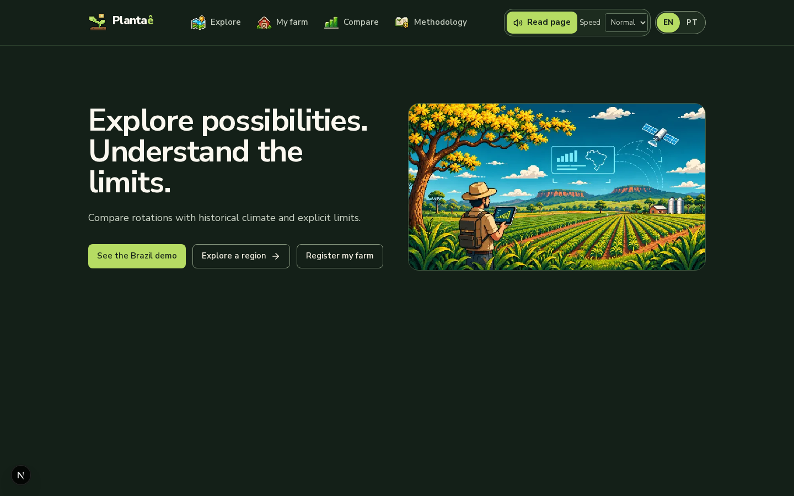
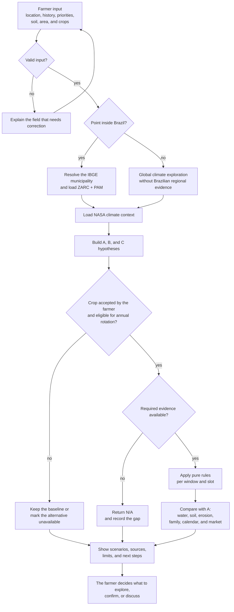
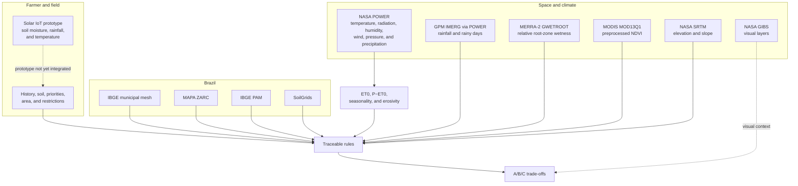
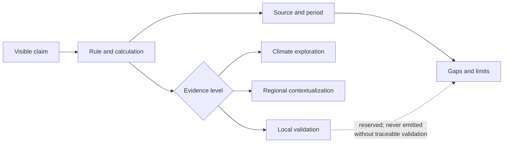
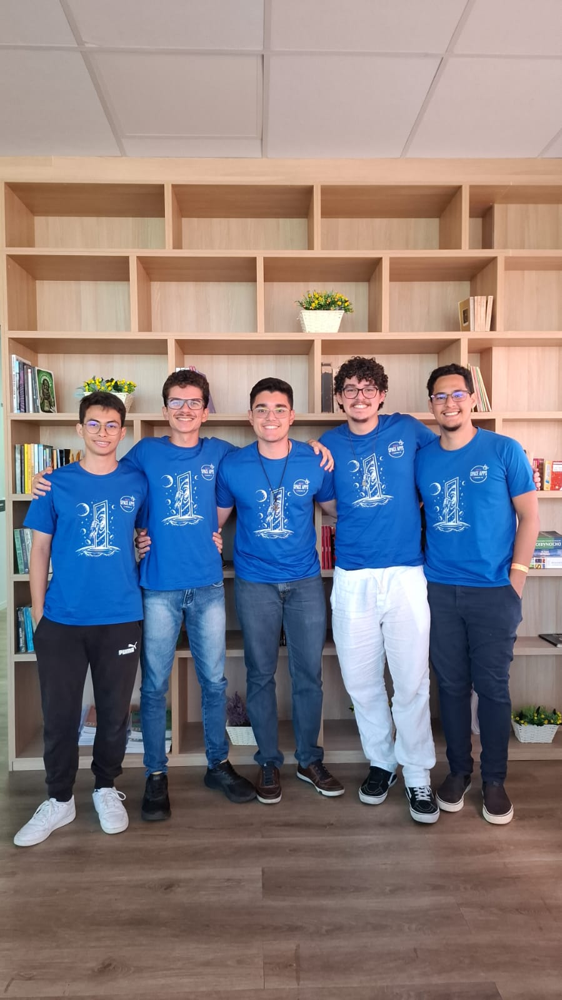

# Plantaê — From Space to Soil. Farmers Decide.

<p align="center">
  
</p>

<p align="center">
  <strong>SilkNASA Team · Plantaê Project · Field Shift Challenge · NASA Space Apps 2026</strong>
</p>

> **What if farmers could explore their choices before planting?**
>
> Meet **Plantaê**: a visual lab where three crop rotation strategies come alive through pixel art, informed by NASA climate data.
>
> **But behind every pixel, there is science.**
>
> We combine NASA observations with soil estimates covering more than 5,000 Brazilian municipalities. Our solar-powered, low-cost IoT prototype measures soil moisture, rainfall, and temperature directly in the field, complementing the spatial limits of satellite data. A virtual assistant makes complex evidence easier to understand.
>
> Farmers swap crops, compare trade-offs, and explore four stages.
>
> **Plantaê. From space to soil. Farmers decide.**

**Plantaê is the official name of the project. Field Shift is the NASA Space Apps 2026 challenge that Plantaê addresses.** Created by the **SilkNASA** team, Plantaê is a visual, bilingual agricultural decision-support MVP that helps Brazilian farmers explore crop rotation hypotheses before planting without hiding uncertainty behind a single score or presenting regional data as field measurements.

The product does not decide for the farmer. It organizes climate history, municipal context, crop evidence, and farmer priorities into three comparable scenarios:

- **A — current intention:** the farmer's confirmed plan, or a continuation clearly labeled as a hypothesis.
- **B — soil and cover:** an alternative selected from eligible crops while respecting farmer restrictions and available evidence.
- **C — water context:** an alternative with documented thermal evidence when possible; it does not promise drought tolerance or lower water use.

Missing data remain **N/A / unknown**. Comparisons are qualitative and traceable, not probabilities of success or agronomic prescriptions.

## The Problem

A crop rotation decision brings together questions that usually live in separate places:

- What has the farmer already planted, and which crops can they operate or sell?
- How does the climate usually behave during each crop window?
- Is there a ZARC record for the crop, municipality, and period?
- What is documented about temperature, cycle, cover, residue, and botanical family?
- What changes when the priority is water, soil, or operations?
- Which conclusions have evidence, which require attention, and which cannot yet be answered?

Plantaê turns these questions into an explorable laboratory. Pixel art communicates the scenarios; the Evidence Center exposes the rules, sources, gaps, and limitations behind them.

## A Core Pillar: Universal, Low-Cost Access to Data

Satellite data make it possible to observe large areas, but their spatial and temporal resolution does not automatically represent what happens in each field. A regional grid average cannot replace a reading taken directly from the soil.

Plantaê therefore combines two scales:

- **from space:** historical and regional context, available even where no field infrastructure exists;
- **on the ground:** a low-cost, solar-powered IoT prototype with **soil-moisture, rainfall, and temperature sensors**.

The goal is to democratize direct data collection. Simple hardware, solar power, and local readings can lower the barrier for farmers with limited connectivity or access to weather stations. In the current MVP, the video demonstrates the physical assembly; measurements do not yet enter the decision engine automatically and remain a future local-evidence layer.

<p align="center">
  <video src="public/assets/team/plantae-iot-assembly.mp4" controls width="720" title="Plantaê IoT prototype assembly"></video>
</p>

**[Watch the Plantaê IoT assembly video](public/assets/team/plantae-iot-assembly.mp4)**

## Farmer Journey

```mermaid
flowchart LR
    A[Choose a location<br/>map, search, or coordinates] --> B[Talk to João<br/>or fill in the farm form]
    B --> C[Provide history, soil,<br/>priorities, and restrictions]
    C --> D[Generate scenarios<br/>A, B, and C]
    D --> E[Edit four slots<br/>in the Rotation Lab]
    E --> F[Compare trade-offs<br/>and evidence]
    F --> G[Explore four stages<br/>through pixel-art stories]
    G --> H[Take questions and evidence<br/>to technical assistance]

    F -. swap a crop .-> E
    E -. recompute analysis .-> F
```



The four slots represent **Year 1/2 × Season A/B**. They are neutral planning spaces: no slot receives an invented date, duration, or agricultural calendar. The four Future Farm Stories stages visualize the hypotheses; they remain scenarios, not forecasts.

## Decision Flow



### What Can Change an Analysis

- the farmer's baseline plan and crop history;
- location and municipal identity;
- available, accepted, or blocked crops;
- declared or documented monthly windows;
- priorities, which change the **order of attention**, not the underlying facts;
- documented agricultural parameters;
- historical climate observations and reproducible indicators.

The engine never turns missing evidence into zero and never infers crop suitability from climate alone.

## How Each Data Source Is Used



| Source | Current use | Value for the farmer | Important limit |
| --- | --- | --- | --- |
| **NASA POWER** | Historical climate and inputs for FAO-56 ET0 | Shows how climate usually behaves during a crop window | Regional grid; not a sensor or forecast |
| **GPM IMERG via POWER** | Historical totals and rainy-day distribution | Separates rainfall amount from rainfall frequency | Rainfall is not crop water demand |
| **MERRA-2 GWETROOT** | Relative root-zone wetness index | Adds water context beyond rainfall alone | Not volumetric field soil moisture |
| **MODIS MOD13Q1** | Pre-processed NDVI: one modelled 250 m point per Brazilian municipality (5,571), plus verified demonstration points | Adds a historical vegetation-greenness signal | Municipal context, not the farm; points on water show N/D; does not diagnose a farm |
| **NASA SRTM** | Elevation, slope classes, and relief hotspots | Makes terrain visible when discussing exposed soil | Does not calculate soil loss |
| **NASA GIBS** | Dated visual SMAP, rain, and imagery layers | Supports visual exploration of spatial context | Raster colors never become measurements |
| **IBGE municipal mesh** | Versioned coordinate-to-municipality resolution | Connects the point to the correct municipal datasets | A municipality does not confirm ownership or agricultural land use |
| **MAPA ZARC** | Records by crop, municipality, and period | Exposes official risk-zoning context for each slot | Absence does not mean unsuitable; zoning is not a guarantee |
| **IBGE PAM** | Municipal harvested area by product | Indicates a recorded local production chain | Does not provide price, profit, or viability |
| **SoilGrids** | 0–30 cm estimates at municipal reference points | Provides a low-cost starting point for texture, pH, and carbon discussions | Spatial estimate, not a laboratory analysis |
| **Farmer input** | History, plan, local soil, crops, and priorities | Keeps the comparison grounded in operational reality | Declared information remains separate from external observations |
| **Open-Meteo** | Current weather and forecast in an independent panel | Adds short-term meteorological context | Not NASA data, a measurement, or a recommendation |
| **Solar IoT prototype** | Demonstrates direct collection of soil moisture, rainfall, and temperature with photovoltaic power | Offers a universal, low-cost path for complementing satellite limits with local evidence | Does not yet feed the repository's engine automatically |

Sources, licenses, and provenance are documented in [SOURCES](docs/SOURCES.md) and [METHOD](docs/METHOD.md).

## What the Farmer Receives

### Three Alternatives Without an Opaque Score

The farmer sees A/B/C side by side. Scenario A remains the reference; B and C never silently replace the farmer's stated plan.

### Six Explicit Trade-Off Axes

1. **Water:** historical `P − ET0` over the same window and documented Kc when available. It does not calculate ETc or irrigation needs.
2. **Soil:** cover purpose, documented nitrogen-fixation potential, residue, and botanical-family diversity.
3. **Erosion:** potentially bare months, rainfall erosivity, and SRTM slope. It does not calculate RUSLE soil loss.
4. **Family/disease:** immediate botanical-family repetition; diseases are named only when documented.
5. **Calendar:** ZARC reading by crop, window, and municipality.
6. **Market/operations:** PAM context and farmer restrictions; no price or profit forecast.

Possible states are **reference**, **better than A**, **similar to A**, **worse than A**, and **unknown**. “Better” or “worse” applies only to that named axis.

### Inspectable Evidence



- **Climate exploration:** climate context exists, but regional crop evidence is insufficient.
- **Regional contextualization:** the loaded package contains a municipality-and-crop match.
- **Local validation:** reserved for future traceable field validation; the MVP never emits it.

### João Explains Evidence in Everyday Language

João receives the selected map point, collects farm information, and explains evidence without hiding unknowns. Dictation supports `pt-BR` and `en-US`, fills the field for review, and never submits automatically. The page reader can start, pause, resume, restart, and stop.

Gemini is optional and used only by the `/results3` prototype when `GEMINI_API_KEY` is configured server-side. Its output is schema-validated and falls back to deterministic text. The core A/B/C engine is rule-based and does not depend on generative AI.

## Architecture

```mermaid
flowchart LR
    UI[Next.js + React<br/>Atlas, João, Farm, Lab, Results] --> API[Zod-validated APIs]
    API --> NASA[NASA and climate adapters]
    API --> DATA[Versioned regional artifacts]
    API --> ENGINE[Pure TypeScript engine]
    ENGINE --> EVIDENCE[Evidence manifest<br/>sources, claims, and gaps]
    EVIDENCE --> UI

    UI --> LOCAL[localStorage<br/>draft and preferences]
    UI --> AUTH[Simple demo login]
    AUTH --> SQLITE[Local SQLite farm store]
    GEMINI[Gemini REST] --> EXPLAIN[/api/explain-farm]
    EXPLAIN --> UI
```

Core principles:

- strict TypeScript and Zod validation at boundaries;
- pure, testable decision functions;
- prepared data with versions, source URLs, and hashes;
- missing values remain `null`/unknown;
- NASA history, forecasts, regional estimates, and local measurements remain separate;
- responsive, accessible UI with keyboard, voice, and read-aloud support.

The login and SQLite store are hackathon features. The SQLite file is temporary in serverless environments and is not a production identity or persistence solution.

## Routes

| Route | Purpose |
| --- | --- |
| `/` | Landing page and Brazil demonstration |
| `/explore` | Atlas, location selection, context, and João |
| `/chat` | Guided conversation with voice dictation |
| `/cadastro` | Simple farm registration |
| `/entrar` | Demo sign-in |
| `/painel` | SQLite-backed farm dashboard |
| `/farm` | History, systems, soil, and priorities |
| `/lab` | Four-slot A/B/C rotation laboratory |
| `/results` | Comparison, trade-offs, and evidence |
| `/results3` | Optional Gemini-assisted explanation |
| `/future-stories` | Four visual stages for the scenarios |
| `/demo` | Guided demonstration |
| `/methodology` | Methods, sources, and limits |
| `/settings` | Accessibility and local-data controls |

`/joao-moods` is an internal visual-review page.

## What Plantaê Deliberately Does Not Claim

- which crop a farmer should plant;
- future yield, revenue, price, NPK, or soil carbon;
- ETc, crop water use, irrigation requirement, or field deficit;
- pest, disease, fertility, or soil-loss diagnosis;
- local validation from municipal averages;
- a probability from the dry-spell experiment—the model did not beat climatology;
- a guarantee based on ZARC, PAM, NDVI, SoilGrids, or NASA;
- automatic ingestion of IoT prototype measurements.

The Climate Risk Lab may display an Open-Meteo forecast, always separated from NASA historical observations and historical scenarios.

## Run Locally

Requirements: Node.js `>=22.13` and npm.

```bash
git clone <repository-url>
cd nasa-2026
npm install
cp .env.example .env.local
npm run dev
```

Open `http://localhost:3000`. The main demonstration works without Gemini. To enable the optional `/results3` explanations, set `GEMINI_API_KEY` in `.env.local`; never expose it through a `NEXT_PUBLIC_` variable.

### Quality Checks

```bash
npm run lint
npm run typecheck
npm run test
npm run test:e2e
npm run build
```

### Data Pipelines

```bash
npm run build:brazil-context
npm run update:brazil-pam
npm run build:brazil-soil
npm run build:brazil-moisture
npm run build:ndvi-municipal-points
npm run fetch:ndvi-brazil -- --resume
npm run validate:ndvi-brazil -- --require-complete
npm run fetch:modis-ndvi -- <site>
npm run fetch:nasa-fixture -- <site>
npm run train:dry-spell
```

Prepared artifacts are versioned. A fallback from one location must never be reused for another.

## Deployment

- The application is designed for Next.js/Vercel.
- `GEMINI_API_KEY` is optional and server-side only.
- Public climate and terrain services have limits; failures must preserve recoverable N/A states.
- SQLite is ephemeral on Vercel and must be replaced before production.
- Production credentials and secrets do not belong in the repository.

## Documentation

- [PROJECT_SPEC](fieldshift_codex/PROJECT_SPEC.md) — product contract
- [METHOD](docs/METHOD.md) — calculations and scientific method
- [SOURCES](docs/SOURCES.md) — sources, licenses, and provenance
- [VALIDATION](docs/VALIDATION.md) — acceptance rules
- [DEMO_SCRIPT](docs/DEMO_SCRIPT.md) — reproducible demonstration
- [SPRINT_LOG](docs/SPRINT_LOG.md) — implementation history and limitations

## Product Principle

> **From space to soil. Farmers decide.**

Plantaê makes evidence explorable. It does not replace farmers, local observation, or technical assistance.

## License and Disclaimers

The original software and documentation in this repository are available under the [MIT License](LICENSE). Third-party data, services, libraries, and media remain subject to their respective licenses and terms; see [SOURCES](docs/SOURCES.md) for provenance and attribution.

Some creative illustrations, animations, and videos used by the project were generated or assisted by generative AI and procedural tools. They are visual communication materials, not scientific observations, measurements, or evidence. The team photograph is a real photograph, not AI-generated, and is included with the permission of the people shown.

Plantaê is an independent, non-commercial hackathon project created by the **SilkNASA** team as its solution to the **Field Shift challenge** in the **2026 NASA International Space Apps Challenge**. **Plantaê** is the project name; **Field Shift** is the challenge name. This repository is not an official NASA repository, product, certification, or endorsement. NASA names, missions, and public datasets are referenced only to identify the challenge and the sources used by the project.

The team has no commercial intent for this hackathon submission.

## Meet SilkNASA

<p align="center">
  
</p>

<p align="center">
  <strong>SilkNASA · Creators of Plantaê</strong>
</p>
